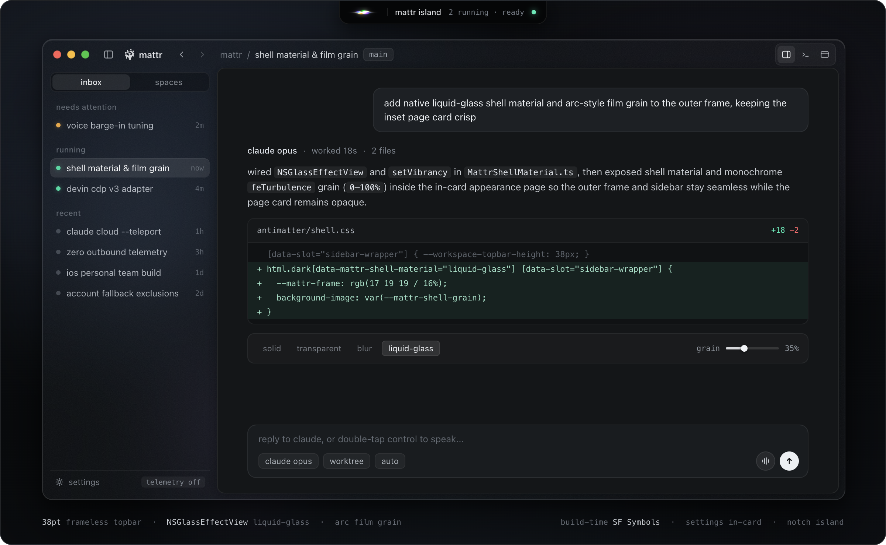
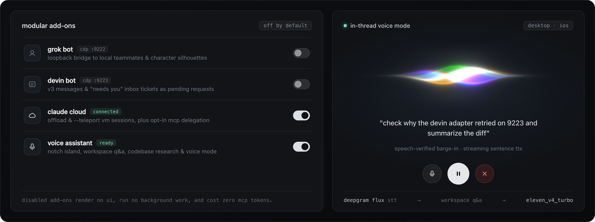

<p align="center">
  <picture>
    <source media="(prefers-color-scheme: dark)" srcset="./antimatter/readme/mattr-mark-dark.svg" />
    <source media="(prefers-color-scheme: light)" srcset="./antimatter/readme/mattr-mark-light.svg" />
    
  </picture>
</p>

<h1 align="center">mattr</h1>

<p align="center">
  a personal fork of t3 code, stripped of telemetry and rebuilt around native macOS craft, modular add-ons, and hands-free voice.
</p>

<p align="center">
  <a href="https://github.com/current/mattr/releases">releases</a> ·
  <a href="https://github.com/pingdotgg/t3code">upstream</a> ·
  <a href="./docs/README.md">docs</a> ·
  <a href="./antimatter/CONTEXT.md">fork notes</a> ·
  <a href="./LICENSE">mit</a>
</p>

<p align="center">
  
</p>

mattr tracks [`pingdotgg/t3code`](https://github.com/pingdotgg/t3code) nightly and runs your local coding agents (claude code, codex, cursor, opencode, grok build, antigravity, kiro, pi, muse code, fx, and any [ACP](./docs/user/providers-acp.md) agent) inside one fast, native-feeling workspace across desktop, web, and iOS.

## what's different from upstream

### macOS shell & customization

- **38pt frameless window** — browser-style outer frame with optically aligned macOS traffic lights, an inset dark page card directly below the topbar, and a transparent sidebar with zero seam.
- **shell materials, color & film grain** — native `NSGlassEffectView` `liquid-glass` (regular or clear), adjustable `blur`, `transparent`, and `solid` materials with a transparency slider, an arc-style shell color (presets or any custom color, fitted to light and dark), and monochrome svg film grain (`0–100%`) across the outer frame and sidebar.
- **solid icon packs** — filled SF Symbols by default (extracted on the build Mac via Swift, zero Apple glyphs committed), or switch live in settings → appearance to solar, phosphor, heroicons, remix, mingcute, fluent, ionicons, material, tabler, hugeicons or lucide.
- **streaming text animation** — pick how assistant replies arrive in settings → appearance: instant, blur reveal with a riding caret, soft fade, rise & settle, or smooth pace; each word animates once, and finished messages render exactly as upstream.
- **mattr sidebar** — project-grouped threads with nested subagent trees, a needs-you filter, crew, and live usage meters; spaces and classic layouts stay one click away, and settings render in-card instead of a modal.

### zero outbound telemetry

- PostHog (`ingest.t3.codes`), Axiom relay OTLP tracing, and mobile `expo-observe` crash reporting are hard-disabled across server, web, desktop, and mobile.
- `mattr connect` relay, local logs, resource monitoring, and any user-configured OTLP export remain intact.

### dynamic island & hands-free voice

- **macOS notch pill** — floating Dynamic Island for live thread state, quick approvals, and hands-free voice control.
- **Lilt GLSL Siri Wave** — 1:1 WebGL shaders across the notch pill, composer waveform, and in-thread voice mode.
- **low-latency voice pipeline** — Deepgram Flux streaming STT, ElevenLabs `eleven_v4_turbo` streaming sentence TTS with full voice tuning, and speech-verified barge-in.
- **workspace brain & in-thread voice mode** — server-hydrated workspace Q&A and codebase research, plus a ChatGPT-style in-thread voice mode on desktop and iOS.

### modular add-ons

every optional integration is **off by default** in settings → add-ons. disabled add-ons render no UI, run no background work, and add zero MCP tokens to agent context.

<p align="center">
  
</p>

| add-on            | transport / runtime        | what it adds                                                                      |
| ----------------- | -------------------------- | --------------------------------------------------------------------------------- |
| `grok bot`        | loopback CDP (`:9222`)     | chat with local Grok Bot teammates in the sidebar with character silhouettes      |
| `devin bot`       | loopback CDP (`:9223`)     | v3 messages and "needs you" inbox tickets surfaced as pending requests            |
| `claude cloud`    | `claude` CLI + opt-in MCP  | offload heavy work to Claude Cloud VMs, send follow-ups, and `--teleport` locally |
| `voice assistant` | local server + notch / web | hands-free summaries, agent steering, workspace Q&A, and in-thread voice mode     |

### fork extras

- **account fallback with exclusions** — automatically switches to another account with usage left when one runs out, with per-account exclusions (`fallbackExcludedInstanceIds`).
- **composer predictions** — after each turn, the empty composer offers your likely next message in your own voice, for every provider; tab or → fills it in.
- **stalled turn flags** — flags running turns with no agent activity for 10 minutes.
- **multi-project delegation** — delegate tasks across local projects from one thread.
- **phone pairing & iOS sideloading** — Tailscale HTTPS pairing links serve mattr's bundled web UI and installable PWA directly; free Apple ID iOS builds work out of the box via `T3CODE_IOS_PERSONAL_TEAM=1`.
- **automatic upstream nightly merges** — CI merges the newest upstream nightly tag into every macOS arm64 prerelease and re-signs with the fork's certificate.
- **`mattr.json` project config** — reads `mattr.json` first and falls back to upstream's `t3.json`.

## install & build

### prebuilt macOS releases

download the latest signed macOS arm64 build from [GitHub Releases](https://github.com/current/mattr/releases). installed builds pick up new CI prereleases through the in-app updater.

### local development

```bash
vp i
vp run dev:desktop
```

runs a separate **mattr (Dev)** window beside any installed app with isolated dev state (`~/.antimatter/dev`) and hot-reloading web UI.

### local signed build & install

```bash
node antimatter/ship-local.mjs --install
```

merges the newest upstream nightly in a separate build checkout (`../mattr-ship`), builds and signs with `~/.antimatter-signing`, replaces `/Applications/mattr.app`, and reopens it. omit `--install` to build without replacing the running app.

### live UI hot-reload

```bash
node antimatter/live-ui.mjs
```

serves renderer changes on `127.0.0.1:5799` so pressing `Cmd+R` in the installed mattr window reloads the UI without interrupting running chats in the backend process.

### iOS personal-team sideloading

```bash
T3CODE_IOS_PERSONAL_TEAM=1 vp run mobile:install ios
```

defaults the bundle id to `com.current.antimatter.mobile`, strips paid-only entitlements (`aps-environment`, associated domains, OTA updates), and signs with a free Apple ID personal team (override `T3CODE_IOS_APPLE_TEAM_ID` and `T3CODE_IOS_PERSONAL_TEAM_BUNDLE_ID` as needed).

## credits & license

mattr is an unofficial personal fork built on [`pingdotgg/t3code`](https://github.com/pingdotgg/t3code). it is not affiliated with or endorsed by T3 Tools, Inc.

source code is licensed under the [MIT License](./LICENSE). T3 Tools, Inc.'s trademarks and branding are not covered by the MIT license — see [TRADEMARK.md](./TRADEMARK.md).
